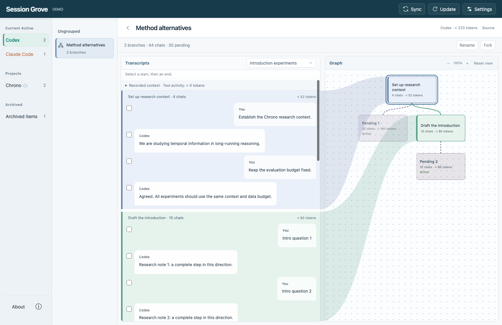
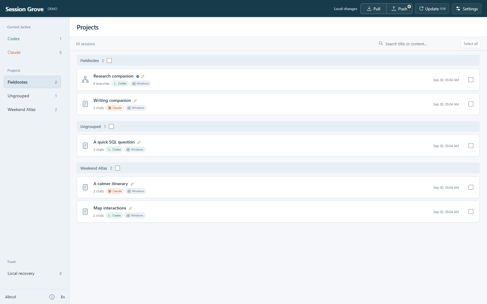
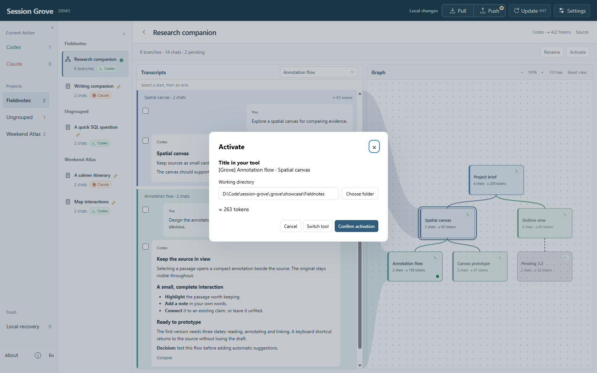

# Session Grove

**English** · [简体中文](README.zh-CN.md)

**Keep the context. Explore a branch. Come back to the work.**

Session Grove is a local session manager for **Claude Code and Codex** on **Windows and macOS**. Organize scattered AI conversations into projects, explore their shared history as a tree, and continue from a useful point.

For research, writing and software projects that outgrow a flat chat list.



## See how your work fits together

A project can span many conversations: an initial brief, competing approaches, a draft and several revisions. Grove brings them together so you can find the context behind an idea without piecing it together from a list of chat titles.

- **Organize by project.** Keep Claude and Codex conversations in one library, with search and editable titles.
- **Explore conversation trees.** See where paths share history and where they diverge. Select a node to read its conversation.
- **Name meaningful stretches of work.** Turn a long transcript into recognizable sections such as “Research questions”, “Compare approaches” or “First prototype”.



## Continue from the context you want

Select a node and **Activate** it to start a continuation from that point while keeping existing branches. Preview the context size and choose a working folder before returning to your agent.

You can also continue in another tool with **Activate as**, or choose how much recorded history to carry forward using the compaction controls.



Grove manages conversation history. You continue chatting and working on files in Claude Code or Codex.

## Spend less time organizing

Optional **Smart Organization** helps name sessions and branch points and sort new conversations into projects. You can edit names yourself, and supported Codex clients can share transcription titles with Grove.

Connect your own OpenAI API key in Settings to enable these features. Naming sends selected conversation text to OpenAI; an API key is not required to browse or organize your library manually.

## Keep your library across computers

Connect a **private Git repository** to sync your conversation library between devices. Pull and Push are manual by default, with optional automatic uploads. Each computer keeps its own choice of active sessions.

Your library stays local unless you enable sync. The sync repository stores readable conversation history, so keep it private. Project files and application credentials are not synced. Trash provides a local recovery period for removed sessions.

## Get started

Install **Node.js 24+** and **Git**, then run:

```sh
git clone https://github.com/MRziyi/session-grove.git
cd session-grove
npm install
npm start
```

Open **http://127.0.0.1:7421** and click **Update** to find your local Claude Code and Codex conversations. Open a session to explore its transcript and tree. Git sync and Smart Organization are optional.

Grove runs in the background, so you can close the terminal. Use `npm stop` to stop it or `npm run status` to check it. You can enable **Start automatically at login** in Settings; it is off by default.

Want to look around first? Stop the service with `npm stop`, then run `npm run demo`. The demo uses sample conversations without reading your personal history. Stop it with Ctrl+C and run `npm start` to return to your own library.

The interface is available in English and Chinese. For help with controls and workflows, open **ⓘ Information** at the bottom of the sidebar.

## Feedback

[Report a problem or suggest an improvement](https://github.com/MRziyi/session-grove/issues) · [Release notes](https://github.com/MRziyi/session-grove/releases)

Please leave private conversation text and credentials out of public reports.

Created by [Ziyi Zhang](https://ziyi-zhang.vercel.app). Inspired by [codex-session-sync](https://github.com/shonngithub/codex-session-sync), [claude-sync](https://github.com/tawanorg/claude-sync) and [Chronicle](https://github.com/geekmuse/chronicle). [MIT License](LICENSE).
